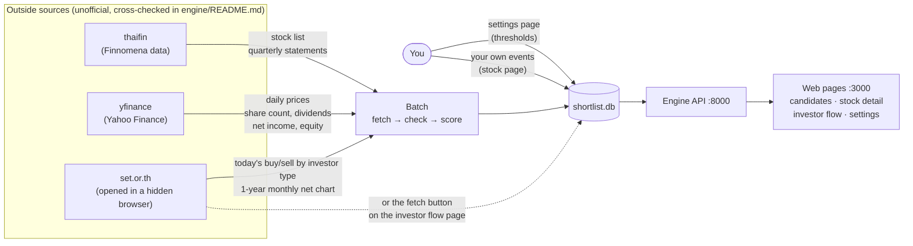
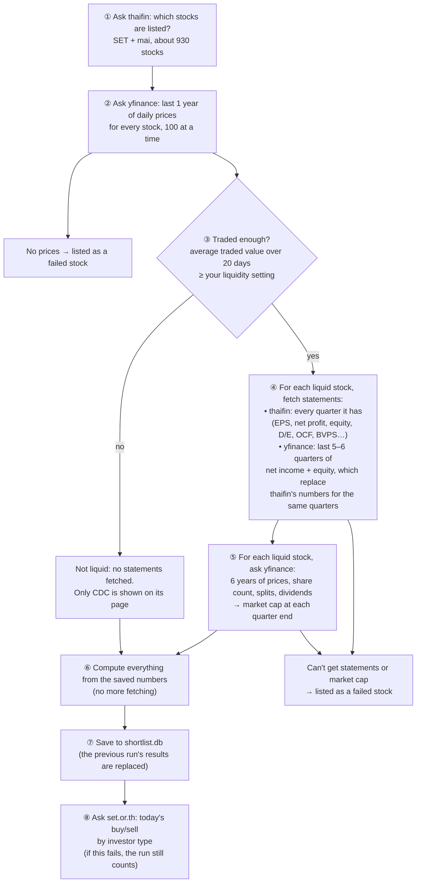
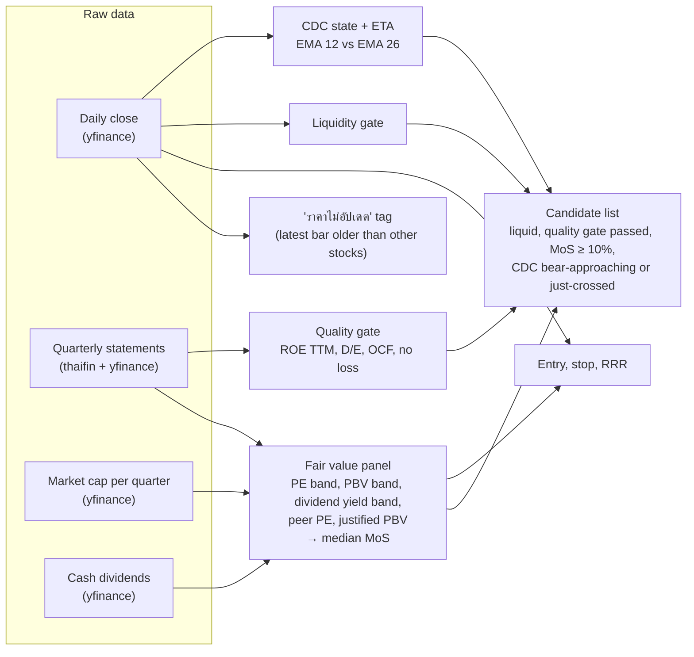

# Where the data comes from

Almost all data comes in through the **batch**. It runs on weekdays at 17:30 (after SET closes at 16:30), or when you press "รัน batch". The web pages read only what is saved in `engine/shortlist.db`. One thing bypasses the batch: the investor flow fetch button.

For the step-by-step code view, see [batch-flow.md](batch-flow.md).

## 1. The big picture

## 2. What the batch fetches, in order

Each step only works on the stocks that made it through the step before, which keeps the slow fetches small.

## 3. Where each number on the screen comes from

## Things worth knowing

- **Prices are from yfinance, not SET.** If the batch runs before Yahoo has today's bar, some stocks show an older date. Those stocks get the "ราคาไม่อัปเดต" tag and a warning line on the candidate list.
- **yfinance overrides thaifin only for recent quarters.** yfinance has just 5–6 quarters, so the 5-year PE/PBV bands still use thaifin's history. Stocks that report in a currency other than THB (for example, PTTEP in USD) keep thaifin's numbers.
- **SET blocks normal downloads.** The engine opens its page in a hidden browser and reads the data from inside the page.
- **Only the latest run's results are kept.** Prices and statements are overwritten on every run. To compare two runs, save the candidate list before running again.
- **Every new source or field is cross-checked first.** It's compared against SET or TradingView, and the result is recorded in `engine/README.md`, before the app relies on it.
